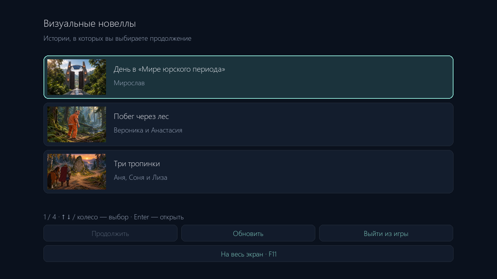
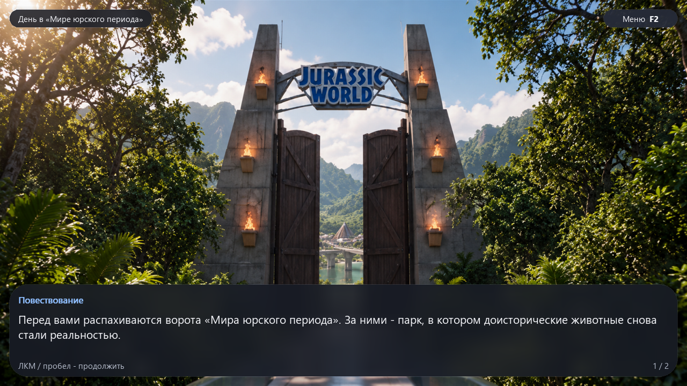

# Визуальные новеллы на Pygame

Движок интерактивных историй и девять готовых новелл по работам учеников. Иллюстрации, текст, развилки и финалы загружаются из JSON; для добавления истории не нужно менять Python-код.





## Готовые истории

| История | Авторы | Сцены | Финалы |
|---|---|---:|---:|
| [Две смены](stories/camp_choices) | Маша | 26 | 9 |
| [День в «Мире юрского периода»](stories/jurassic_day) | Мирослав | 30 | 11 |
| [Первый экстрим](stories/first_extreme) | Рома | 39 | 16 |
| [Переулок](stories/noir_alley) | Платон | 14 | 5 |
| [Три двери](stories/enchanted_castle) | Полина Степанова | 10 | 7 |
| [Необычный день в лесу](stories/forest_rescue) | Матвей | 8 | 1 |
| [Побег через лес](stories/forest_escape) | Вероника и Анастасия | 24 | 8 |
| [Три тропинки](stories/three_paths) | Аня, Соня и Лиза | 17 | 6 |
| [Три убежища](stories/outbreak) | Полина Климина | 31 | 16 |

## Быстрый старт

Python 3.12 и Pygame 2.6.1. В Windows / PowerShell:

```powershell
git clone https://github.com/MichaelBogdanov/novels.git
cd novels
py -3.12 -m venv .venv
.\.venv\Scripts\python.exe -m pip install -r requirements.txt
.\.venv\Scripts\python.exe main.py
```

В Linux/macOS создайте окружение через `python3 -m venv .venv`, установите зависимости и запускайте `.venv/bin/python main.py`. Проверки CI выполняются в Linux; интерактивная работа на macOS отдельно не проверялась.

Без аргументов открывается библиотека с обложками. Историю можно открыть мышью или выбрать стрелками / колесом и нажать Enter. В игре небольшая кнопка «Меню» справа сверху (или F2) раскрывает верхнюю панель. По умолчанию она свёрнута, чтобы оставлять арт открытым. Кнопка «Истории» в этой панели возвращает в библиотеку, «Продолжить» восстанавливает текущее прохождение. Открытие другой истории начинает её заново. Сохранений после закрытия программы нет.

Если в `stories` нет подходящих пакетов, появляется «Пока нет доступных историй». Кнопка «Обновить» перечитывает папку. Пакеты с ошибками JSON или отсутствующими ресурсами пропускаются с сообщением в терминале; ошибка декодирования арта при открытии оставляет игрока в библиотеке.

```powershell
# Полный экран или запуск конкретной истории
.\.venv\Scripts\python.exe main.py --fullscreen
.\.venv\Scripts\python.exe main.py stories/three_paths/story.json

# Проверка всех историй и тесты движка (демо не требуется)
.\.venv\Scripts\python.exe main.py --validate
.\.venv\Scripts\python.exe tools/validate_stories.py
.\.venv\Scripts\python.exe -m unittest discover -s tests -v
```

Размер окна автоматически составляет 90% рабочего стола. Полный экран использует разрешение монитора; F11 и Alt+Enter сохраняют сцену и позицию чтения при переключении. Текст и области кликов перестраиваются под размер окна.

Интерфейс использует системную типографику, скруглённые карточки и тёмные матовые панели. На широком экране библиотека показывает крупную обложку рядом со списком, на высоком - над ним. Подсветка плавно реагирует на наведение и смену выделения; управление доступно сразу, без ожидания анимации. Размытие игровых фонов и миниатюры обложек подготавливаются заранее и кешируются.

Кнопки внизу библиотеки и клавиши **F6** / **F7** отключают анимацию подсветки и прозрачность соответственно. Настройки действуют до закрытия программы, в том числе в игре и журнале. Для запуска сразу с этими настройками можно задать переменные окружения `VN_REDUCED_MOTION=1` и `VN_REDUCED_TRANSPARENCY=1`; системные настройки доступности автоматически не считываются.

## Состав репозитория

Публикуются движок, тесты, документация и готовые игровые пакеты. `works/`, `stories/demo/`, локальное окружение, черновые генерации, референсы и результаты локальных проверок исключены через `.gitignore`. Они остаются на компьютере автора. Демо при необходимости можно запустить локально явным путём, но в библиотеке оно не показывается.

Новая история: создайте `stories/<имя>/story.json` и положите ресурсы рядом с ним. Для публикации нового готового пакета добавьте его папку в разрешённый список `.gitignore`; перед коммитом выполните проверки выше. Не добавляйте исходные ученические работы в индекс Git.

## Управление

| Действие | Управление |
|---|---|
| Допечатать страницу / следующая страница или сцена | ЛКМ или пробел |
| Выделить вариант | Колесо мыши или ↑ / ↓; наведение движущегося указателя |
| Подтвердить выбор | Enter или ЛКМ по свободной области - выделенный вариант; ЛКМ по варианту - этот вариант |
| Вернуться на один шаг | Кнопка «Назад», ←, Backspace, колесо вверх вне списка вариантов |
| Открыть журнал и перейти к записи | Кнопка «Журнал» или Tab, затем ЛКМ по записи |
| Прокрутить журнал | Колесо мыши или ↑ / ↓ |
| Прокрутить текст очень длинного варианта | Shift + колесо |
| Переключить fullscreen | F11, Alt+Enter или кнопка «На весь экран» / «Окно» |
| Выйти из fullscreen | Escape (если открыт журнал, сначала закрывается он) |
| Полностью скрыть интерфейс | H, ПКМ или кнопка «Скрыть»; Escape в оконном режиме |
| Вернуть интерфейс | H, ПКМ, ЛКМ или пробел; Escape в оконном режиме |
| Включить / выключить звук | M или кнопка звука |
| Свернуть / раскрыть верхнюю панель | Небольшая кнопка «Меню» справа сверху или F2 |
| Включить / выключить анимацию подсветки | F6 или кнопка в библиотеке |
| Включить / выключить прозрачность панелей | F7 или кнопка в библиотеке |
| Открыть библиотеку | «Меню» → «Истории» |
| Закрыть программу | Кнопка «Выход» / «Выйти из игры», крестик окна или Alt+F4 |

Первое нажатие во время печати только раскрывает текущую страницу. При показе арта печать приостанавливается; нажатие для возврата интерфейса не продвигает сюжет. Пробел не выбирает ветку случайно. Журнал блокирует взаимодействие со сценой под ним.

Колесо вниз выделяет следующий вариант, вверх - предыдущий, даже когда все варианты помещаются на экране. Выделение показано рамкой и счётчиком; длинный список автоматически прокручивается до выбранного пункта и имеет полосу прокрутки. Колесо останавливается на краях списка, стрелки позволяют перейти с первого пункта на последний и обратно. Само вращение колеса не подтверждает выбор: нажмите Enter или ЛКМ по свободной области, чтобы выбрать выделенный вариант без наведения курсора. Клик непосредственно по варианту выбирает его; кнопки интерфейса сохраняют свои действия. При скрытом интерфейсе первый клик только возвращает его, а открытый журнал блокирует выбор. Для чтения отдельного варианта выше области списка используйте Shift + колесо. Дробные события тачпада накапливаются до целого шага; дублирующие события старых кнопок колеса игнорируются.

## Формат истории

Одна папка - переносимый пакет; один JSON - одна новелла. Все пути ресурсов вычисляются **от папки JSON**, независимо от текущей рабочей директории.

```text
stories/my_novel/
  story.json
  art/room.png
  art/garden.jpg
  audio/type.wav       # необязательно
  fonts/reading.ttf    # необязательно
```

Минимальный пример с ветвлением:

```json
{
  "version": 1,
  "title": "Моя история",
  "start": "room",
  "settings": {"text_speed": 36, "volume": 0.25},
  "nodes": {
    "room": {
      "speaker": "Аня",
      "text": "За окном светало.\nКуда отправиться?",
      "art": "art/room.png",
      "choices": [
        {"text": "В сад", "target": "garden"},
        {"text": "Через двор в сад", "target": "garden"},
        {"text": "Остаться", "target": "stay"}
      ]
    },
    "garden": {
      "text": "В саду меня уже ждали.",
      "art": "art/garden.jpg",
      "ending": {"type": "good", "title": "Новая встреча"}
    },
    "stay": {
      "text": "Утро прошло в тишине.",
      "art": "art/room.png",
      "ending": {"type": "neutral", "title": "Тихое утро"}
    }
  }
}
```

### Поля

- `version`: версия формата, сейчас `1`.
- `title`: название окна и верхней панели.
- `start`: ID начального узла.
- `nodes`: объект с произвольными уникальными ID узлов. ID не выводятся игроку.
- `text`: непустой текст; `\n` разделяет абзацы. Переносы и страницы рассчитывает движок до начала печати, поэтому строки не скачут. Длинные слова тоже переносятся.
- `speaker`: необязательное имя говорящего.
- `art`: обязательный путь к изображению в каждом узле. PNG/JPEG рекомендуются. Изображение масштабируется с сохранением пропорций до заполнения экрана, края могут обрезаться.
- Ровно одно из полей `next`, `choices`, `ending` определяет завершение узла.
- `next`: ID следующей сцены для линейного перехода.
- `choices`: непустой массив объектов `{ "text": "Подпись", "target": "ID" }`. Повторяющиеся цели разрешены; циклы тоже. Число вариантов не ограничено, список прокручивается.
- `ending`: `{ "type": "good|bad|neutral", "title": "Название" }`. Каждый тип получает отдельный цвет и подпись; игрок может начать сначала или вернуться к последнему выбору.
- `settings`: необязательный объект. `text_speed` - 1-150 символов в секунду, `volume` - 0-1. `font` - путь к TTF/OTF с нужными символами; `typing_sound` - путь к короткому WAV/OGG.

Без пользовательского шрифта используется системный Segoe UI / DejaVu Sans / Arial. Для переносимой истории на других языках приложите свой шрифт с нужным покрытием и лицензией. По умолчанию движок синтезирует исходный короткий тон печати: 740 Гц, 30 мс, с плавным затуханием. Каждая печатаемая буква или знак вызывает звук; пробелы и переносы беззвучны. Раскрытие всей страницы не создаёт звуковой всплеск. При недоступном аудиоустройстве игра продолжает работу с предупреждением в терминале.

## Как устроен откат

`Session` хранит последовательность **реальных посещений**, а не ищет предыдущую сцену в графе: `(node, page, choice, offset)`. Это корректно работает при слиянии веток, повторных посещениях и циклах. Каждая новая страница - отдельный шаг. Назад возвращает предыдущую страницу сразу прочитанной. Выбор сохраняется в записи перехода, поэтому журнал различает варианты с одинаковой целью. `offset` указывает начало страницы в исходной строке: после изменения размера окна откат возвращает к тому же тексту, даже если он теперь переносится иначе. Счётчик оставшихся страниц пересчитывается по текущей компоновке.

Возврат к записи удаляет все более поздние шаги. На узле выбора снова доступны все варианты; можно создать новую ветку прохождения. Из финала кнопка возврата ищет последнее посещение узла выбора. История хранится в памяти до закрытия приложения; сохранений на диск и переменных отношений в этой основе пока нет.

## Архитектура и расширение

- `vn/story.py`: загрузка, проверка графа, история посещений; не зависит от Pygame.
- `vn/app.py`: отображение, печать, звук, ввод, страницы, журнал и оформление финалов.
- `vn/display.py`: определение разрешения монитора, подбор размера окна и fullscreen.
- `vn/layout.py`: адаптивная геометрия, отступы и размеры шрифтов в пикселях текущего окна.
- `vn/text.py`: разбиение текста на строки и страницы с привязкой к исходным символам.
- `main.py`: выбор пакета и запуск / проверка.
- `tests/test_engine.py`: тесты ветвлений, слияния, отката, циклов, валидации и взаимодействия с UI через SDL dummy.
- `vn/catalog.py`, `vn/library.py`: поиск пакетов и экран выбора.
- `tools/validate_stories.py`: проверка опубликованных ресурсов и достижимости сцен.

Рабочая поверхность всегда имеет фактическую ширину и высоту окна: при fullscreen на мониторе 2560×1440 это поверхность 2560×1440. Фиксированного разрешения сцены и масштабирования готового интерфейса нет. Шрифты сразу растеризуются в нужном размере, а панели и области кликов рассчитываются в пикселях текущего окна.

`Layout` получает размер от Pygame, вычисляет типографическую единицу из короткой стороны и размещает панели относительно краёв. Нижняя панель занимает примерно 20-24% высоты в обычном окне (на маленьких экранах сохраняется минимум для читаемого текста); количество строк определяется её внутренней высотой и метриками шрифта. В узком окне название переносится над кнопками, а сами кнопки при необходимости располагаются в несколько рядов. Короткий список вариантов расположен над текстом и занимает только необходимую высоту; длинный список прокручивается. Панели вариантов и финала ограничены по ширине, чтобы меньше перекрывать арт. Журнал использует доступную область окна. После resize/fullscreen компоновка и области кликов обновляются перед обработкой следующего ввода.

Интерфейс заполняет экран с любым соотношением сторон без служебных чёрных полей. Только фоновый арт масштабируется с сохранением пропорций до заполнения окна, поэтому его края могут обрезаться. Размер рабочего стола определяется через [Pygame display.get_desktop_sizes](https://www.pygame.org/docs/ref/display.html#pygame.display.get_desktop_sizes). Текстовая панель рисуется через `SRCALPHA`; кешируются до восьми исходных изображений. Звук реализован через [Pygame mixer.Sound](https://www.pygame.org/docs/ref/mixer.html); для своих звуков используйте короткие семплы.

Чтобы добавить условия, инвентарь или параметры персонажей, расширьте формат и валидатор, а в `Frame` сохраняйте полный снимок изменяемого состояния. Тогда откат будет восстанавливать также параметры. Для миграций используйте новое значение `version`; не связывайте ID сцен с Python-функциями.

`--validate` проверяет структуру, ссылки и наличие ресурсов; декодирование изображений выполняется при показе сцены. Некорректный JSON, отсутствующие ресурсы и неверные переходы дают понятную ошибку в терминале.
